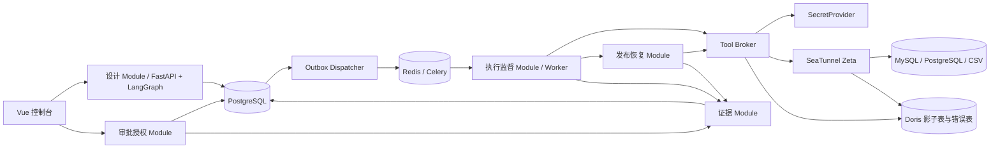
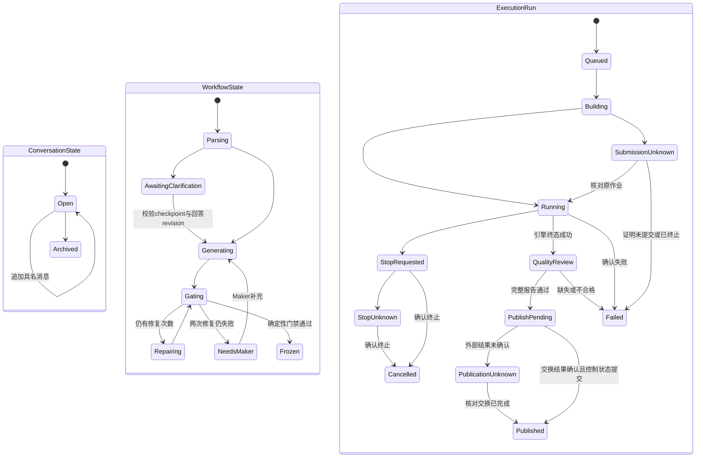

# ETL-Agent 首版架构

本文件把已确认的首版规格映射为可验证的 Module 和持久化协议。产品策略已在 Q1–Q33 确认；本文的 Interface、实体拆分和状态名是 **proposed 实施设计**，不是已实现或已验证的引擎事实。术语以[词汇表](../GLOSSARY.md)为准，范围与阈值以[首版规格](specs/etl-agent-v1.md)为准，验证顺序见[实施计划](planning/implementation-plan.md)。没有业务实现或通过真实链路验收的隐含前提。

## 1. 运行拓扑与职责

标准验收入口是 Linux 容器 Docker Compose；Windows 通过可用的 Docker 环境运行。Vue 控制台调用 FastAPI，LangGraph 持久化设计进度，PostgreSQL 保存授权和运行事实，Redis 承载 Celery 消息；Worker 通过受管工具调用 SeaTunnel Zeta、数据库和 SecretProvider。SeaTunnel 负责数据搬运，控制面不拉取海量业务数据。



图中外部操作箭头表示执行路径，不赋予调用者绕过授权的权限。连接测试、只读探查、样本采集、试运行、Secret 物化、提交、取消、DDL、发布、回退和清理均经 Tool Broker；模型只能提出 ToolIntent。低风险读取可以由 PDP 自动授权，但仍限制资源、行数、超时并记录证据。Prepare 只验证已有受管探查事实并冻结准备单，不启动外部作业或提前建表；Commit 必要的外部复核作为独立受管只读步骤留下结果和有效期。

## 2. 小 Interface 与深 Module

以下为语言无关的拟议 Interface，不是待直接复制的源码。输入引用均含服务器验证过的 Scope；调用方不能通过传入 tenant_id 获得权限。Interface 的契约包含顺序、授权、幂等性与失败方式，不只是方法签名。

| Module / Seam | 小 Interface（拟议） | 隐藏的 Implementation 与调用契约 |
|---|---|---|
| 设计 | `advance(scope, design_id, expected_revision, input) -> DesignOutcome`；`freeze(scope, candidate_id, expected_revision) -> PipelineVersionRef` | ConversationState 与 WorkflowState 分别保存；中断恢复校验归属和revision；最多两次修复；结构化门禁、确定性渲染与版本冻结集中处理。结果可能为需要澄清、候选通过、拒绝或版本冲突，模型文本不成为执行指令。 |
| 审批授权 | `prepare(actor, intent) -> PreparationRef`；`decide(actor, preparation_id, slot, decision) -> ApprovalReceipt`；`commit(actor, preparation_id, idempotency_key) -> RunReceipt` | PDP、冻结事实、角色槽独立性、24小时有效期、指纹漂移和账号再校验，以及一次PG授权事务。成功响应只表示已接受，不表示引擎已执行或正式表已发布。 |
| 执行监督 | `drive(command_envelope) -> RunObservation`；`request_stop(actor, run_id, reason) -> StopReceipt`；`reconcile(scope, run_id) -> RunObservation` | 命令验签、消息去重、所有权、引擎作业关联、监督采样、取消确认和未知结果处理。重复drive不产生第二次业务提交；停止请求已接受不等于已停止。 |
| 发布恢复 | `advance(actor_or_manifest, run_id, expected_revision) -> PublicationObservation`；`request_rollback(actor, snapshot_id) -> PreparationRef`；`reconcile(scope, publication_id) -> PublicationObservation` | 质量门禁、物理目标互斥、完整快照、发布意图、外部事实核对、水位切换、保留与回退。推进仅能执行已批准manifest中的步骤；回退创建独立审批流程。 |
| 证据 | `append(transaction, event) -> EvidenceRef`；`checkpoint(scope) -> SignedCheckpoint`；`verify(export, trusted_checkpoint) -> VerificationReport` | 按账本序号串行追加、哈希链、签名、导出与篡改检测。关键控制面事件与对应事实同事务写入；外部事件记录请求、结果或未知状态，不捏造外部原子性。 |

Tool Broker 是执行监督与发布恢复内部共享的授权 Seam：`invoke(command_context, approved_step, parameters) -> StepOutcome`。它从持久化授权 manifest 读取允许的动作、资源、先后关系、预算和有效条件，不接受模型临时附加步骤。连接器只拿到受限上下文，不拿到可任意执行的管理员客户端。

### 真实变化对应的 Adapter

| Seam | 首版 Adapter | 共同契约与差异 |
|---|---|---|
| SecretProvider | 环境主密钥支持的加密存储；Vault KV v2 | `resolve(secret_reference, execution_context)`只允许已授权引用与版本；凭据按需物化，不进入消息、日志或制品；故障和轮转语义均测试。主密钥缺失时拒绝依赖该密钥的服务启动，不自动生成替代密钥。 |
| LLM Provider | OpenAI兼容真实端点；确定性演示 Provider | `generate(sanitized_request) -> StructuredCandidate`使用同一结构校验。报告显式标注Adapter与模型；真实模型失败不能静默转演示，演示不计模型准确率。 |
| Engine | 真实SeaTunnel Zeta；故障模拟 Adapter | `submit / observe / stop / discover`返回统一的观察或未知结果；模拟器注入提交超时、重复消息、指标丢失和取消延迟。模拟器用于L1，不能替代L2或证明真实引擎具备幂等性。 |

上述 Interface 是测试入口。HTTP、Celery、LangGraph 节点只是调用这些 Module 的适配方式，不能各自复制授权、指纹或发布规则。避免为每张表增加只有CRUD转发的独立Module。

## 3. 持久化实体与隔离

共享PostgreSQL采用应用层强制隔离，不承诺每租户独立数据库或Worker。除明确的基础身份目录外，业务实体携带不可为空的`tenant_id, project_id`；跨实体引用使用包含Scope的组合外键或等效约束。查询、下载、Checkpoint恢复和后台任务都从身份授权推导Scope；客户端ID只用来定位，不用来授予归属。

| 实体组 | 持久化事实与约束 |
|---|---|
| Tenant / Project / User / ProjectMembership | 账号状态、密码哈希、项目角色与撤权版本；账号不能仅通过前端角色切换获得权限。独立账号作为验收职责身份，注册多个账号的真人身份核验属于平台外管理责任。 |
| Connection / SecretReference / MetadataProfile | 规范化物理资源标识、允许Schema/表、凭据版本；Profile保存结构指纹、采集时间、有效期、近似统计与脱敏样本。原始凭据不保存在Profile。 |
| ConversationState / WorkflowState / Candidate | 分别保存消息历史、带revision的LangGraph checkpoint和可编辑EtlPlan；恢复验证项目、所有者及修订号，不能把一次旧回答应用到已变化的候选。 |
| Pipeline / PipelineVersion / Artifact | 冻结的计划、渲染HOCON、规则、连接器能力与编译器版本、各制品摘要；已冻结内容只追加新版本，不原地覆盖。 |
| Preparation / ApprovalSlot / ApprovalDecision | 冻结指纹、风险、预算、manifest、过期时间与具名决定；槽位唯一，申请人禁止自批；同一准备单两个高风险槽不能由同一用户占用。撤销和失效作为新事实保存。 |
| CapabilityConsumption / ExecutionRun / ManagedCommand / Outbox | `jti`唯一；准备单执行机会、Scope内Commit幂等键、Run、command_id与派发事件关联。授权事务防止并发重复Commit；Outbox投递状态不能代替Run执行状态。 |
| EngineAttempt / MetricObservation / QualityReport | engine job关联证据、请求摘要、观测时间、数据来源、累计/瞬时口径、可用性、重试计数；不要通过把多次尝试的累计数相加制造业务行数。 |
| ManagedTarget / TargetOwnership / PublicationIntent | 跨项目共享物理资源规范标识的全局冲突检测；授权范围内隐藏其他项目详情但拒绝冲突登记。保存排他所有权、单调代次、发布前后表身份与待核对状态。 |
| PublishedSnapshot / WatermarkState / RetainedSnapshot | 正式目标对应的版本、质量报告、源覆盖区间、当前维度状态、规范化增量合并状态及其摘要、前后水位、保留旧表身份和到期时间。 |
| EvidenceEvent / EvidenceCheckpoint / BenchmarkCase / EvaluationReport | Scope内连续证据序号与前序哈希、签名和可信外部检查点；评测用例版本、Provider、环境及具体失败明细。 |

全局目标互斥不能只用`tenant_id + project_id + table_name`，否则两个项目可锁住同一物理表的不同逻辑连接。必须规范化集群/数据库/表身份并校验别名；无法确认物理等价性时拒绝宣称隔离已成立。Redis或进程内锁不能充当最终事实来源。

## 4. 三层独立状态

状态名为proposed设计；约束是已确认策略。ConversationState只记录交互，不因引擎成功而自动结束；WorkflowState恢复不重新执行已冻结版本；ExecutionRun只代表一次批准的执行机会。



Preparation另有草拟冻结、待审批、拒绝、过期、失效、可Commit及已消费的生命周期。执行未知、停止未知和发布未知均保留资源所有权并阻止危险动作，不以超时自动标成失败。发布后回退是新的受管操作，原发布记录保留，不抹去原事实。

## 5. 不可变事实、指纹与审批有效性

拟议canonical序列化使用明确版本的JSON canonical形式：稳定键排序、UTF-8、确定数字/空值规则、禁止NaN/Infinity、时间统一UTC；有顺序语义的数组保留顺序，无序集合先规范排序。冻结对象保存`canonicalization_version`和原始canonical字节，摘要算法为SHA256；不要只对人类展示格式或随机化加密后的字节取执行指纹。

PipelineVersion包含EtlPlan及其派生配置、Schema映射、QualityContract、渲染器/规则/连接器能力版本。Preparation指纹再绑定环境、规范物理资源、MetadataProfile Schema指纹、预算、发布/回退方案、SecretReference版本、PDP策略版本与授权manifest。审批决定绑定准备单ID和指纹；具名身份及决定时间单独记账。源端正常业务值变化不导致准备单自动失效，Schema漂移、凭据轮转、策略变化或执行定义变化必须重新准备审批。

PDP由确定性策略给出P0–P3：P0为最高风险且拒绝；P1正式发布、发布后回退和凭据轮转需要独立双审批；P2受限写入/试运行同样双审批；P3受限只读可以自动授权。模型不能改等级或豁免。Maker不能自批，两个高风险职责槽不能由同一用户完成；验收操作员也使用独立账号。

Commit再次检查24小时期限、当前账号/成员资格、Maker与Checker独立性、槽位完整性、操作员权限、策略版本及冻结事实。审批不能续期；撤权立即影响未Commit的申请。凭据版本改变不允许偷偷切到新版本继续运行；执行期间撤权或密钥不可用采用安全终止/禁止发布策略，记录原因，不能扩权恢复。

Celery Beat到时只创建本次待审批执行申请，不复用历史批准自动启动。每次实际运行都建立独立Preparation；批准一个PipelineVersion不等于批准其无限期周期执行。重复调度tick用计划实例的唯一业务键去重，不能制造多个相同申请或绕过Commit。

## 6. 一次授权事务与受管命令

1. Commit定位幂等键，校验调用主体、原请求摘要与Preparation。相同键不同请求冲突；相同键重试返回同一RunReceipt，但仍校验查询权限。
2. 服务器完成当前冻结事实和审批检查，签发绑定工具、主体、环境、资源与指纹的Ed25519 Capability，TTL为5分钟。令牌不放入模型上下文，不用于长期Worker认证。
3. 在一次PostgreSQL事务中锁定准备单执行机会、复核审批revision/账号资格、验证Capability并唯一消费`jti`，创建ExecutionRun、签名ManagedCommand、Outbox和证据事件。事务回滚时这些事实全部回滚；返回签名令牌不等于消费成功。
4. Outbox Dispatcher至少一次投递。Worker认证派发来源并验签ManagedCommand，检查command_id、Run、manifest摘要、环境、当前拥有权及允许状态；**不再次消费原Capability，也不以已超过5分钟否定合法运行**。
5. Run可以运行10分钟或等待队列更久；Capability的5分钟是接受执行授权的消费窗口，不是Run寿命。ManagedCommand具有独立的执行阶段、撤销和终态约束，不因消息重发获得新权限。

manifest明确允许创建哪些影子/错误表、提交何种配置、读取哪些源、执行哪些受控步骤，以及质量通过后的单表发布；所有动态表名需受命名规则和资源上界约束。已批准发布步骤无需由模型临时申请扩权；取消可按manifest内安全动作执行，范围外操作和发布后回退需要新的Preparation。Worker不得从消息里的自由SQL、Secret明文或任意URL推导权限。

Capability防重放保护授权入口，command_id幂等保护消息消费，EngineAttempt核对保护外部提交；三者不能互相替代。不存在PG、Redis、SeaTunnel与Doris的分布式exactly-once承诺。

## 7. 外部提交、监督与物理目标所有权

提交前持久化EngineAttempt、确定性业务关联标识、配置摘要、目标与请求阶段。返回jobId后持久化关联；提交超时或Worker崩溃后优先按最终版本支持的作业标识、标签和配置证据查找原作业。最终版本是否支持预分配jobId、同ID去重或可靠发现必须实测，不能从拟议Interface推断。

无法唯一证明未提交时进入SubmissionUnknown，拒绝盲重试和正式发布；即使消息重新投递也只能reconcile。证明原作业不存在或已终止后才能根据独立的重试授权决定下一步；不能因本地没有jobId认定引擎没有作业。

同一物理目标从构建完整影子结果到发布确认串行。PG持久化所有权和单调代次，Worker每次受管动作检查代次；短期租约用于检测失联，**TTL到期不自动释放物理目标或允许新Run接管**。旧Worker/SeaTunnel可能仍写入，且Doris DDL不天然验证本地fencing值。恢复者必须隔离旧Worker的调用路径，确认旧引擎任务终止及在途动作结果，核对表身份后才可转移所有权；无法证明时保留目标隔离状态并要求运维介入。不能将PG锁或租约包装成跨系统fencing保证。

监督约2秒采样，记录observed_at、engine_observed_at（若提供）、累计或瞬时类型、连接器范围、数据集/阶段标识、重置/重试、缺失和时效。源读取、解析后、去重/关联后、质量判定、有效、拒绝及最终sink/shadow行数分别保存，不把逻辑记录当成SQL扫描行数。Preparation必须冻结输入/输出阶段、记录单元、重复累计办法和比例分母；放大比按这些明确的输入/输出边界计算，不能默认用完整shadow行数除以本批增量。拒绝率在同一质量判定阶段按拒绝记录/已判定记录计算，同一记录多个错误码只计一次；零分母显示暂无数据。字节预算必须明确为可验证的SinkWriteBytes等口径，不能当网络传输量或源库扫描字节。

默认100,000行、256MiB、10分钟、2倍放大、20%拒绝率；比例中断在至少100条后启用，最终质量判断不受最低样本数限制。到时限或指标超限立即请求停止并禁止发布，但承认观测滞后和在途批次超调。必要指标缺失、陈旧或不能解释重置时告警并请求停止/转未知，禁止把缺失当0。取消响应不等于停写；必须确认终态并排除仍在运行的尝试后才能清理。严格物理资源上限由额外引擎/运行环境保证，首版不作此承诺。

## 8. 质量分流与数据保护

QualityContract区分转换、必需校验与业务过滤：过滤必须显式定义并计数，不能静默删除。成功形成SeaTunnel记录后，所有适用必需规则通过的记录进入有效分支，否则进入ErrorRecord；分支互斥、覆盖且NULL语义明确。多条错误原因不能扩大拒绝行数，错误表写失败使报告不完整并禁止发布。

对账只在同一冻结质量判定阶段、同一记录单元且完成重试去重后比较`已判定记录 = 有效记录 + 拒绝记录`；源接收、解析、去重、join、历史合并和业务过滤的前后计数分别保存，不能把完整影子表行数与本批输入直接相等，也不能宣称`源读取 = shadow + error`。QualityReport逐项关联数据集、阶段及测量来源；重试时优先使用可证明的最终逻辑计数，不把引擎重发累计值当成唯一行数。两个sink不默认跨表原子，未通过质量报告的部分结果不得发布。

SourceParseFailure包括坏CSV引号/列数、驱动解码失败、输入截断或无法证明完整读取；这类异常发生在质量转换之前，整批失败、禁止发布，保存受管源引用、错误定位及脱敏诊断，不假造逐条ErrorRecord或完整错误数。禁止SKIP配置静默吞掉解析错误。采样展示也必须受权限、数量和脱敏约束。

普通错误字段可保留原值，敏感字段只保留脱敏摘要；首版不提供敏感原值解密查看。错误原值不得被复制到审计、提示词、异常栈或普通日志。外部LLM只接收需求文本和经过筛选的元数据；Secret、原始行样本、原始错误值禁止发送，Provider请求/响应日志必须脱敏。源文件引用应受管而非任意可访问URL，并纳入项目授权与保留策略。

## 9. 完整快照、发布核对与增量恢复

首版是有界全量/水位增量，不是CDC。订单以更新时间和主键排序、按主键合并并使用重叠回看窗口；用户维度采用当前状态，变化需要重算受影响历史订单。不保证源表间事务快照、物理删除传播或无限迟到修改。演示采用受控批次，缺少稳定源键或更新时间语义时拒绝声称不重不漏。

ShadowTable必须是包含历史保留结果的完整待发布快照，不能用本批增量直接替换正式表。规范化增量合并状态包括已覆盖订单键/源字段、维度状态、去重规则版本及水位；其存储形态待实现验证，但必须属于可恢复的快照事实，不能仅凭最终宽表反推已经丢弃的源状态。控制面只保存引用与摘要，大规模合并由数据面完成。

发布前检查引擎确认成功、所需指标和完整质量报告、计数口径、影子Schema、目标所有权、版本指纹及manifest。空输入默认禁止替换，除非冻结版本明确批准空表发布。Doris不自动校验两表Schema一致性，平台必须自行比较目标结构和批准结构。

Doris单表发布形式为：

```sql
ALTER TABLE db.target REPLACE WITH TABLE shadow
PROPERTIES('swap' = 'true');
```

交换后target是原shadow新数据，shadow是原target旧数据。只承诺这次两张OLAP表的元数据交换原子性，不承诺多个表、两个sink或跨库事务；不能用`swap=false`，它会删除原target。旧表身份、权限和依赖对象行为须按选定版本验证。

### 发布意图与故障核对

1. 持有目标所有权，在PG写入PublicationIntent：预计target/候选表的稳定身份、结构摘要、Run、批准步骤、待发布快照/水位和旧快照引用。
2. Broker验证当前身份后执行单条swap；记录外部请求与可用结果。PG和Doris之间无分布式事务。
3. 确认外部交换后，在PG事务内更新PublishedSnapshot、canonical增量状态引用和WatermarkState，并写证据；所有控制状态指向同一快照revision。
4. 崩溃后比较实际表身份与发布意图：仍为发布前组合则可在重新验证授权与排除在途请求后继续；为发布后组合则补交PG控制事实；其他组合或证据不足进入PublicationUnknown并隔离目标。

稳定表身份/标记的可获取性和跨swap语义是技术验证门槛。不能只凭表名、行数、数据相同或“本地尚未写成功”决定是否交换，也不能在未知时盲目swap回来。首次发布前应由受管准备步骤建立可辨认的正式目标和候选对象，或验证明确的首次发布协议；Prepare本身不建表。

Watermark只在发布确认后的PG事务推进。失败无推进；发生swap但PG未更新时先核对补交，不允许用旧水位启动下一Run。保留最近一次成功发布前的完整表及对应canonical增量状态，默认7天；回退另行双审批，恢复目标快照、水位及合并状态，使后续可以从该覆盖区间安全重放。回退是新的发布意图，同样处理跨库结果不明；旧快照被删/改、已过期或身份不明就拒绝。发布前清理只针对已确认终止且从未发布的资源，不能误删交换后承载旧正式数据的表。

## 10. 证据、威胁与故障验证

EvidenceEvent按Scope与账本流保存连续序号、时间、主体、事件类型、制品/准备单/Run引用、前序哈希及canonical事件摘要；签名检查点绑定流标识、序号、头哈希和key_id。导出校验签名、序号、哈希链及预期检查点，不在事件里保存凭据和敏感业务值。

哈希链能发现修改和重排；若删除尾部，必须依靠校验者此前独立保存的可信EvidenceCheckpoint识别。数据库和签名密钥均由攻击者掌握时没有绝对不可篡改保证。管理员与密钥托管属于受信边界；首版人工导出检查点并离线验证，不宣称第三方存证或自动外部锚定。

| 威胁 / 故障 | 必须保持的行为 | 可通过Interface验证的证据 |
|---|---|---|
| 自批、同人双槽、撤权后Commit | 拒绝，原审批与拒绝原因保留 | 审批授权Interface + PG真实事务测试 |
| 跨租户ID或Checkpoint猜测 | 不泄露对象、拒绝恢复/下载 | 设计、授权、执行各Interface的Scope隔离用例 |
| 提示注入请求任意SQL/URL或泄露Secret | 不成为manifest权限、不发送敏感内容 | 设计Interface + Provider捕获请求 + Broker拒绝记录 |
| Capability重放、并发Commit | 一次消费、一个Run，或事务回滚 | PG唯一约束/并发事务测试，不用内存fake证明 |
| Outbox/Celery重复消息、Worker崩溃 | 同Run和command；未知提交不重提 | 执行Interface + 故障Engine Adapter（L1）及真实Zeta断连（L2） |
| 租约过期、旧Worker恢复 | 目标仍隔离，未证实旧任务终止不接管 | 执行/发布Interface的并发及失联恢复测试 |
| 指标丢失、拒绝率超限、取消超时 | 禁止发布，确认终态前不清理 | 执行监督Interface，记录检测/请求/终止时间与最终观测 |
| 坏CSV或错误sink失败 | 整批失败或报告不完整，禁止发布 | 真实源和Doris Adapter集成，不只测试已解析行 |
| swap前后进程崩溃 | 核对对象身份后继续或补交；禁止盲swap | 发布Interface + PG/Doris真实故障注入 |
| 回退旧表缺失或水位不匹配 | 明确拒绝，不伪装恢复 | 发布恢复Interface验证目标和canonical状态一致性 |
| 篡改/删除/重排账本及尾部截断 | 给出具体断点/可信检查点不匹配 | 证据verify对真实导出的破坏实验 |

## 11. 兼容性门槛与交付证据

版本通过依赖锁定和镜像摘要记录；实现前验证兼容组合，不把文档的latest当部署承诺。官方研究文档基线是SeaTunnel 3.0.0与Doris 4.x，以下仍是未完成的技术验证：

- Zeta预分配/关联jobId、提交超时发现原作业及取消终态；无法可靠发现时保留未知状态，不伪造幂等提交。
- 所选连接器累计字节和重试指标的语义、缺失处理及Supervisor计量；无可靠口径则字节预算验收不能通过。
- 已解析行双分支或DataValidator路由与Doris错误表映射、重试对账、源端解析失败整批拒绝。
- Doris表稳定身份、Schema预检、swap后旧数据落点、PG/Doris崩溃核对、回退与水位重放；确定性对象身份识别是实施计划T03的必过门槛，不能仅凭表名或行数推断是否已swap。
- SecretProvider两个Adapter、真实LLM与演示Provider切换，及Scope授权不被Adapter绕过。

安全确定性用例全部通过，至少20个版本化生成用例在最多两次修复后正确率目标90%；真实Provider成绩单独报告。L0静态检查与L1模拟不能顶替L2：L2必须由真实SeaTunnel和数据库完成正常发布、超限阻断/恢复及发布后回退，保留环境、数据、耗时和失败证据。当前Docker服务连通与资源仍待验证，不宣称集成已通过。

相关高代价决策：[结构化计划唯一执行源](adr/0001-structured-plan-source-of-truth.md)、[一次授权事务与受管命令](adr/0002-transactional-authorization-and-managed-command.md)、[完整快照与单表交换恢复](adr/0003-full-snapshot-publication-and-reconciliation.md)。

官方依据（内容是外部资料，最终行为仍按锁定版本实测）：[Zeta生命周期](https://seatunnel.apache.org/docs/3.0.0/engines/zeta/rest-api-job-lifecycle/)、[DataValidator](https://seatunnel.apache.org/docs/3.0.0/transforms/data-validator/)、[Doris REPLACE](https://doris.apache.org/docs/4.x/sql-manual/sql-statements/table-and-view/table/ALTER-TABLE-REPLACE/)。
