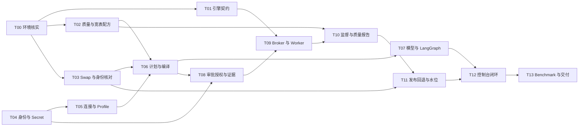

# ETL-Agent 首版实施计划与票据草案

状态：早期技术主题与阶段门槛参考；产品基线已经用户确认，尚未开发业务代码。以下 T00–T13 是本地技术主题标识，不是 GitHub Issue 编号。实际实施已改按[纵向切片 V01–V28](ticket-breakdown-v1.md)发布为 28 张子票和 35 条直接阻塞边，接取顺序以[真实票号映射](ticket-map-v1.md)及远程实时依赖为准；本文件不另行形成重复工单。

本计划依据 [首版规格](../specs/etl-agent-v1.md)、[架构设计](../architecture.md) 和 [领域术语](../../GLOSSARY.md)。正式规格已发布为 [GitHub #1](https://github.com/yb2915722928-cpu/-ETL-Agent-/issues/1)，V01–V28 均关联现有 #1 并标记 ready-for-agent。远程写操作继续使用当前 workspace 的 deck 工具，不重建或改写父规格。本文件中的技术主题依赖用于解释早期分析，不覆盖已确认纵向切片的真实阻塞关系。

## 目标与顺序

先验证真实集成条件及高风险引擎契约，再完成授权内核和一个可发布的纵向链路，最后补齐恢复、界面及评测。身份与密钥模块可以和技术探查并行。阶段门槛未通过时，其他不依赖它的工作可以推进，但不得将模拟结果填入 L2 验收或弱化已确认要求。

不估算尚无资源依据的日历工期。本计划不授权开始业务实现、不安装或启动依赖、不发布 GitHub 工单，也不执行部署。

| 阶段 | 工作 | 退出条件 |
|---|---|---|
| M0 集成事实 | T00–T03 | 固定候选版本、驱动与镜像摘要；真实提交/查询/取消、质量对账、交换核对有证据；必要字节指标口径明确 |
| M1 受管设计 | T04–T07 | 独立账号、加密凭据、探查、真实模型澄清恢复、确定性编译及不可变版本可演示 |
| M2 授权与执行 | T08–T10 | 双审批、防重放、Outbox 重复投递、真实运行、监督与质量发布阻断通过 |
| M3 发布与恢复 | T11 | 完整影子表发布、水位推进、交换故障核对、取消清理和上一版本恢复通过 |
| M4 控制台与验收 | T12–T13 | 六类界面闭环、真实模型报告、L0/L1/L2、两条真实演示和可重复部署包齐备 |

## T00：核实并记录真实集成环境

- 位置：规格下的实施票；建议标签 `ready-for-agent`，前提是能获取必要运行环境。依赖：无。
- 交付：Docker 服务连通性、可用 CPU/内存/磁盘、镜像访问、端口、模型可用条件的脱敏报告；候选版本和配置矩阵；随后可复用的环境检查方式。
- 验收：实际查询 Docker server；实际启动候选依赖后做健康检查。模型凭据通过受管方式配置，不写入仓库。记录镜像版本/摘要、驱动、SeaTunnel connector、Doris 表类型与测试结果，不使用浮动 `latest` 作为交付基线。
- 已知情况：此前仅证实 Docker/Compose 客户端存在，Docker server 查询未成功；WSL 查询返回 `Wsl/E_ACCESSDENIED`，可用内存未知。不得据此判定 Docker 已停止或擅自绕过访问限制。
- 失败处理：具体记录缺失资源；没有真实模型时仍可做其他验证，但生成准确率与完整真实模型演示保持未通过。

## T01：验证 SeaTunnel 作业生命周期与指标契约

- 位置：实施票，技术探查。依赖：T00。
- 交付：一个有界真实作业的提交、关联、查询、取消、最终状态和指标样本；明确引擎返回值到受管运行状态的映射。
- 验收：提交成功；模拟提交后响应丢失；验证作业标识能否可靠查询。核实自定义标识及重复提交的实际行为，不以未经验证的参数推断幂等。无法确认原作业时禁止再次提交。
- 验收：取消请求和真实终止分开记录；终止前禁止清理影子表或释放目标的排他执行权。记录取消对 checkpoint 和在途写入的实际影响，不把取消当作数据库回滚。
- 指标门槛：取得可归属到 Run 的累计读取行数、写入字节数、时长和分支计数来源；说明单位、批次/重试影响、观测延迟和缺失行为。若必要字节指标不能可靠获得，该预算验收不通过；不得改用估算后声称通过。

## T02：验证质量分流、完整对账与宽表配方

- 位置：实施票，技术探查。依赖：T00。
- 交付：MySQL/ PostgreSQL 有界读取及 CSV 到 Doris 的已验证配置配方；订单与当前用户维度的完整宽表构建方式；有效与错误表的明确 schema。
- 验收：正常值、NULL、多个质量错误、相同主键、同时间戳和维度变更，逐一检查预期业务结果。SQL 双分支须互斥且穷尽；如采用 DataValidator，验证错误表映射、多表 sink 和重试行为，不能将文档能力当作实际集成结果。
- 验收：已经可靠解析的记录满足“已判定 = 有效 + 拒绝”，同一条记录多错误码仅计一次。引擎重试及多个 sink 不得导致报告重数；错误数据与 Run、记录身份关联，访问受控，敏感原值不进入日志或模型上下文。
- 解析失败：CSV 坏引号/列数/解码错误以及 JDBC 读取失败，不能静默跳过；无法证明完整读取或可靠形成记录时整批失败。记录文件引用、位置（如可获得）和脱敏诊断；不承诺坏 CSV 均能逐条分流。
- 水位门槛：验证完整影子表保留历史、主键合并和维度更新；固定用于预算与放大比的输入阶段，避免把多源计数或重复读数混成分母。

## T03：验证 Doris Swap、旧表身份与故障核对

- 位置：实施票，技术探查。依赖：T00。
- 交付：同库受管 OLAP 正式表/影子表的真实交换与再次交换记录；固定对象身份识别方式；发布恢复流程证据。
- 验收：单条 `REPLACE WITH TABLE ... PROPERTIES('swap'='true')` 后正式名对应新结果、另一表名对应旧结果；事前执行 schema 门禁，不能依赖 Doris 自动检查一致性。
- 故障注入：交换前失败、交换已完成但响应丢失、交换后控制面事务未完成。必须识别实际对象身份后核对状态，不能因一次超时盲目再交换。
- 并发门槛：同一真实目标表从构建到发布串行；失联 Worker、锁续约失败或控制面崩溃时不允许新 Run 与旧 Run 同时写/发布。探明排他凭证和对象身份检测方式。
- 范围：单表发布；不宣称跨表、跨 sink 或 Doris/PostgreSQL 分布式原子事务。

## T04：项目身份、职责分离和 SecretProvider

- 位置：实施票。依赖：无；可与 M0 并行，真实集成检查仍需要 T00。
- 交付：认证、租户/项目/成员/角色、独立演示账号；加密存储和可选 Vault KV v2 Adapter；凭据引用、版本及轮转。
- 验收：跨租户 ID 猜测、越权资源引用、角色越权和撤权后的身份授权操作均被拒绝；禁止仅依赖前端隐藏按钮。提供职责独立性的身份判定能力；申请人自批、同人双槽的完整审批链路在 T08 验收，不能成为本票依赖未来模块的退出条件。敏感密钥缺失时拒绝相关服务启动，不新生成密钥覆盖旧凭据。
- 验收：两种 SecretProvider 的存取、拒绝和版本变化；API、消息、日志与导出不泄露明文，Worker 只在授权范围内物化凭据。

## T05：连接、只读 Profile 与受管样本

- 位置：实施票。依赖：T04。
- 交付：首版连接能力矩阵、安全连通测试、Schema/类型/近似统计及脱敏样本的探查 Interface。
- 验收：MySQL、PostgreSQL、CSV 的成功与失败探查；受限账号、资源白名单和采样预算；恶意元数据/连接参数不升级为任意工具调用。运行期间的正常数据变化不自动当作 Schema 漂移。
- 验收：凭据及原始样本不发往模型；文件引用按项目授权校验，不接受任意主机路径或未登记网络端点作为执行资源。

## T06：结构化计划、确定性编译与不可变版本

- 位置：实施票。依赖：T05、T02、T03。
- 交付：首版受支持的 EtlPlan schema/操作集合、确定性 HOCON 渲染、语法及 Schema/资源/Secret/质量/预算门禁、版本和 Diff。
- 验收：相同规范化输入生成稳定摘要；修改计划、Schema、资源、规则等事实导致摘要变化；已有版本不能修改。派生 HOCON、DAG 与字段映射保持同源，未支持的操作明确拒绝。
- 验收：不确定性的字段顺序、创建时间和近似统计不错误污染执行事实指纹；凭据版本和适用策略版本必须参与 Preparation 的绑定事实。

## T07：真实模型、澄清与可恢复设计工作流

- 位置：实施票。依赖：T06。
- 交付：OpenAI 兼容模型端点和模型 Profile、确定性演示 Adapter、LangGraph checkpoint、有限修复和 Studio 设计交互。
- 验收：缺失业务参数时中断；进程重启/跨请求后按正确租户项目恢复；最多 2 次自动修复；预算增大、规则删除和业务语义变化需要澄清。
- 验收：至少一个真实模型生成正确受支持计划，另一个配置验证切换能力并如实记录可调用条件。真实模型失败显式报错，不静默切到演示结果。

## T08：Prepare/Approve/Commit、单次授权与证据

- 位置：实施票。依赖：T04、T06。
- 交付：确定性 PDP、不可变 Preparation、独立职责槽、24h 到期、审批决定、Commit 幂等、Ed25519 Capability、Replay Guard、事务 Outbox 和证据写入/校验。
- 验收：P0 拒绝，P1/P2 双批，P3 按权限/白名单/预算授权；每次运行独立审批。Prepare 不创建外部影子表或提交数据面作业。
- 验收：申请人自批、同人占据双槽、指纹/凭据版本/策略/权限漂移、审批到期、审批人或操作员撤权、Capability 过期或重放均在实际审批/Commit 链路被拒绝；Capability 消费、Run、Outbox 一起提交或一起回滚。
- 验收：否决、批准、提交和后续关键操作留证；导出签名检查点；修改、删除、重排事件和对照已保存检查点截断尾部均可被独立校验发现。

## T09：受管命令、Outbox Relay 与 Worker

- 位置：实施票。依赖：T01、T08。
- 交付：Tool Broker 受管副作用出口、受管命令签名与作用域、可靠 Relay、Worker 领取与恢复、引擎关联及运行记录。
- 验收：消息重复、Worker 重启、消费后确认丢失，均不创建第二个业务 Run 或盲目重交作业。Capability 已在 Commit 消费，Worker 验证受管命令，不将同一 token 再消费一次。
- 验收：令牌 5 分钟指授权消费窗口，不把它误当 10 分钟作业寿命；延迟消息仍须检查命令撤销/有效性和已批准运行范围。审批中的发布步骤可在冻结范围内执行，不能由模型增添新副作用。
- 验收：不确定提交进入待核对状态；重复定时触发使用同一触发身份，且不会把先前批准变成无限期重复执行权。

## T10：运行监督、质量报告和发布否决

- 位置：实施票。依赖：T09、T02。
- 交付：Run 级指标、吞吐图、脱敏日志、错误码分布、质量对账、超限取消与诊断 Interface。
- 验收：默认 100000 行、268435456 字节、600 秒、2 倍、20%，约 2 秒观测；比例中断至少 100 条后启用，但最终总要检查；零分母显示暂无数据。其余预算不等待 100 条。
- 验收：覆盖阈值两侧、指标缺失/滞后、解析失败、作业成功但报告不完整、空输入、取消确认失败；这些情况不得错误发布。记录观测及取消时间、最终值和超调，禁止宣称零超调。

## T11：完整影子发布、回退与增量水位

- 位置：实施票。依赖：T10、T03。
- 交付：排他目标流程、完整 shadow、发布意图记录、交换及状态核对、发布快照、水位提交、发布前清理和独立审批的发布后回退。
- 验收：所有故障点下正式表、水位和关联版本可核对；失败不推进水位；恢复后无重数或漏数。同时间戳、重叠回看和当前维度变化有预期对照，不承诺任意久远迟到修改。
- 验收：最近一次旧快照保留 7 天；已过期、被修改、对象身份不明或存在未终止写入时拒绝回退/清理。回退需要相应的增量中间状态仍可重建，不能只把目标表换回后继续使用新水位。
- 验收：源物理删除、历史维度还原和多个业务目标表原子发布明确不支持。自动计划触发只生成待审批申请，不能复用一次授权无限运行。

## T12：控制台纵向业务闭环

- 位置：实施票。依赖：T07、T11。
- 交付：总览、连接资产、Studio、版本 Diff、准备单/审批/运行中心、安全与 Benchmark 的中文界面及完整错误状态。
- 验收：独立账号轮换完成一次真实链路；展示事实漂移、到期、待核对、取消中、发布阻断、恢复失败等状态；按钮动作严格匹配服务端权限与状态。
- 实施方式：各前序票同步提供最小可演示界面或明确的前端消费 Interface；本票负责全链路整合和可用性，不把前端首次反馈推迟到全部后端完成。

## T13：版本化 Benchmark、双演示与交付包

- 位置：实施票。依赖：T12。
- 交付：Compose 初始化、中文演示与运维手册、版本矩阵、L0/L1/L2 数据集及脚本、真实模型评测和签名证据导出。
- 验收：约 1000 订单/100 用户，5% 异常发布与 30% 异常中断两条真实链路；另行验收发布后回退。用预期业务结果比对实际正式表，不只看作业成功。
- 模型：至少 20 个固定版本用例；最多 2 次修复后的正确率至少 90%，记录首次/最终结果、真实 Provider、模型、输入与预期和失败原因。确定性 Provider 不计入模型成绩。
- 安全：安全硬门槛 100% 通过；报告固定测试集上的 P0/P1 拦截率、漏拦截、误拦截及分母。L2 必须真实数据库、引擎和发布；模拟只计 L0/L1。
- 报告：逐项关联规格验收 ID、命令/输入、配置、日志摘要、数据差异和失败明细；记录性能条件与结果，不给出未经测量的企业性能承诺。

## GitHub 映射与后续分诊

用户已确认按 V01–V28 纵向切片发布，现有 `spec` #1 下的 28 张 `spec-ticket` 及 35 条原生阻塞边已建成，详见[真实票号映射](ticket-map-v1.md)。T00–T13 不分别建票，上述技术主题依赖不替代实际票据依赖。若后续独立探索范围显著扩大，可另建 `map` 与带 research/prototype 标签的子票，并将结论链接回现有规格，避免重建父规格或重复实施范围。

| 草案状态 | 建议分诊角色 | 判断依据 |
|---|---|---|
| 环境/凭据条件明确、依赖已完成 | `ready-for-agent` | 工作可执行且有明确验收 |
| 等待用户提供实际模型或部署条件 | `needs-info` | 缺少具名条件；保留可并行工作 |
| 尚待评估探查结果或范围影响 | `needs-triage` | 尚不具备确定实施输入 |
| 确需人在外部系统完成的配置 | `ready-for-human` | 明确列出必须由人执行的动作 |

发布前读取现有工单，避免重建重复规格；保存本次规格确认原话与准确出处，不重构早期访谈为伪逐字引文。开始/切换/完成工单按 deck 规范 report，内容更新与处理关系上报分别完成。此文件中的建议标签不是已经写入 GitHub 的事实。

## 变更与技术失败处理

- 如 T01–T03 发现核心要求在选定版本上不成立，先记录证据、可选方案和验收影响；不得关闭问题、隐去指标或用模拟假装通过。版本更换和内部实现调整由实施者验证；削弱已确认语义需要重新确认。
- M0 完成后再锁定真实版本及资源要求；本次研究仅使用 SeaTunnel 3.0.0 与 Doris 4.x 文档作能力参考，不等于该组合已经集成通过。
- 新版本、预算/规则/资源/策略变化重新 Prepare；正式规格调整需同步验收矩阵与 ADR，不能只修改单张实施票。
- 本阶段交付的是规格与可执行的工作拆分，不是已运行系统、测试通过证明或上线声明。
